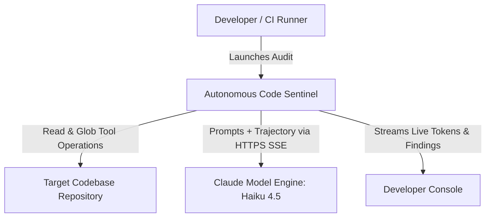
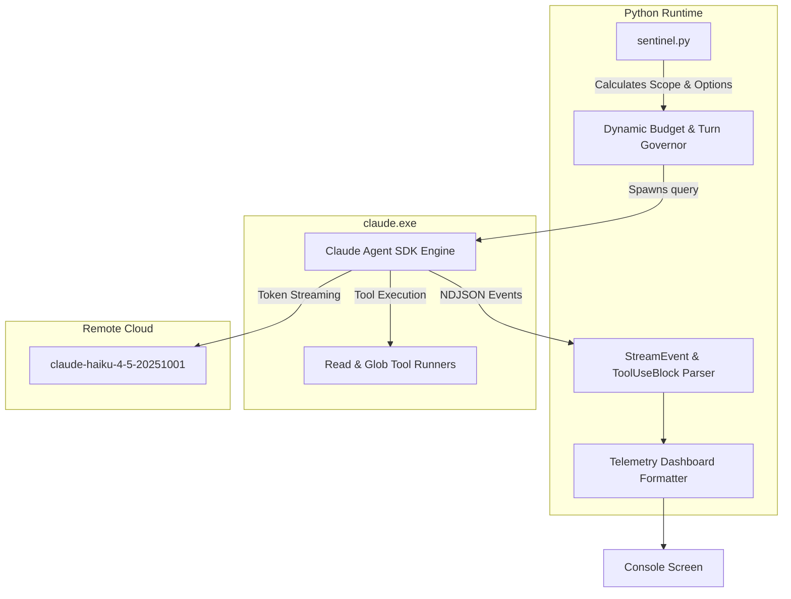
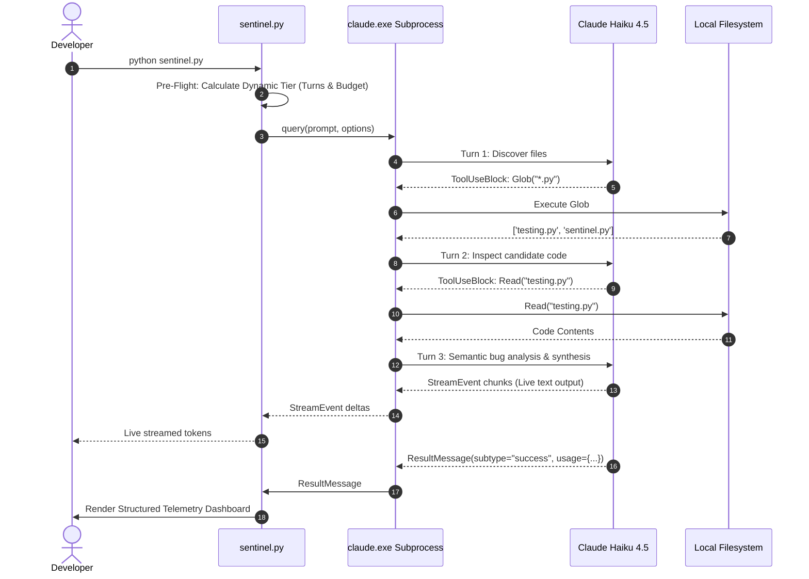

# 🏛️ System Architecture & Design
## Autonomous Code Sentinel

---

## 1. C4 Architecture Models

### 1.1 Level 1: System Context Diagram

### 1.2 Level 2: Container & Process Model

---

## 2. Sequence Diagram (Multi-Turn Trajectory)

---

## 3. Architecture Decision Records (ADRs)

### ADR-001: Dynamic Sizing over Static Constraints
- **Context:** Static turn and budget limits fail in production; 4 turns and $0.03 cannot audit multi-file codebases, while unlimited execution creates severe financial risk.
- **Decision:** Implement pre-flight dynamic budgeting based on candidate file counts (Tiers: 6/15/25 turns, $0.10/$0.40/$1.50 budgets).
- **Status:** Accepted.

### ADR-002: In-Process Read/Glob Tools over Network RPC
- **Context:** Tool calling latency must be minimized for developer pre-commit hooks ($< 20$ seconds total SLA).
- **Decision:** Use native built-in `Read` and `Glob` tools executed directly in-process by the SDK runner rather than spawning external stdio MCP processes.
- **Status:** Accepted.

### ADR-003: Model Engine Tier (Haiku 4.5)
- **Context:** Fast turnaround and high cost-efficiency are mandatory for pre-commit hooks.
- **Decision:** Use `claude-haiku-4-5-20251001` as the default engine.
- **Status:** Accepted.
