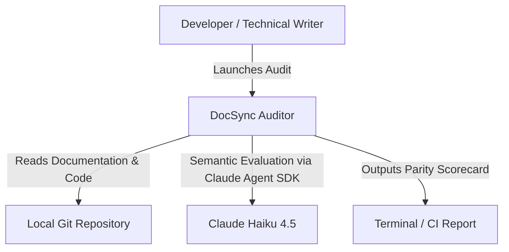
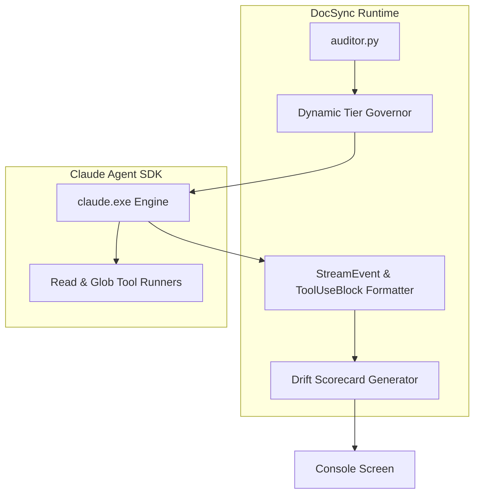

# 🏛️ System Architecture & Design
## DocSync Auditor

---

## 1. C4 Architecture Models

### 1.1 Level 1: System Context Diagram

### 1.2 Level 2: Component Architecture

---

## 2. Architecture Decision Records (ADRs)

### ADR-001: Read-Only Governance in Phase 1
- **Decision:** The agent performs audit and parity analysis only; it does not write or mutate markdown files autonomously without human sign-off.
- **Status:** Accepted.

### ADR-002: Dynamic Footprint Sizing
- **Decision:** Budget and turn ceilings scale dynamically with the sum of markdown and code files discovered.
- **Status:** Accepted.
